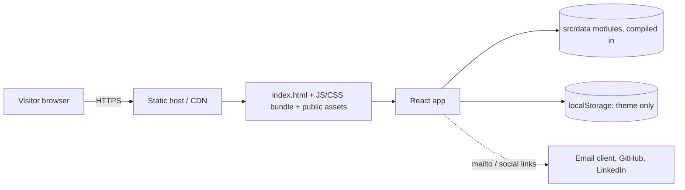
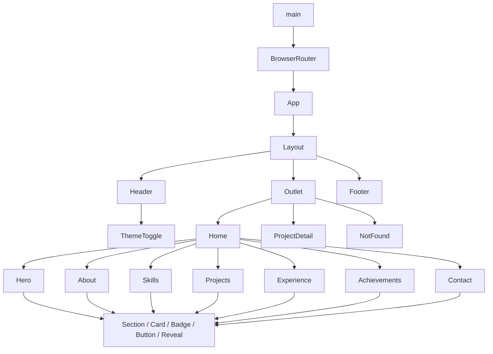
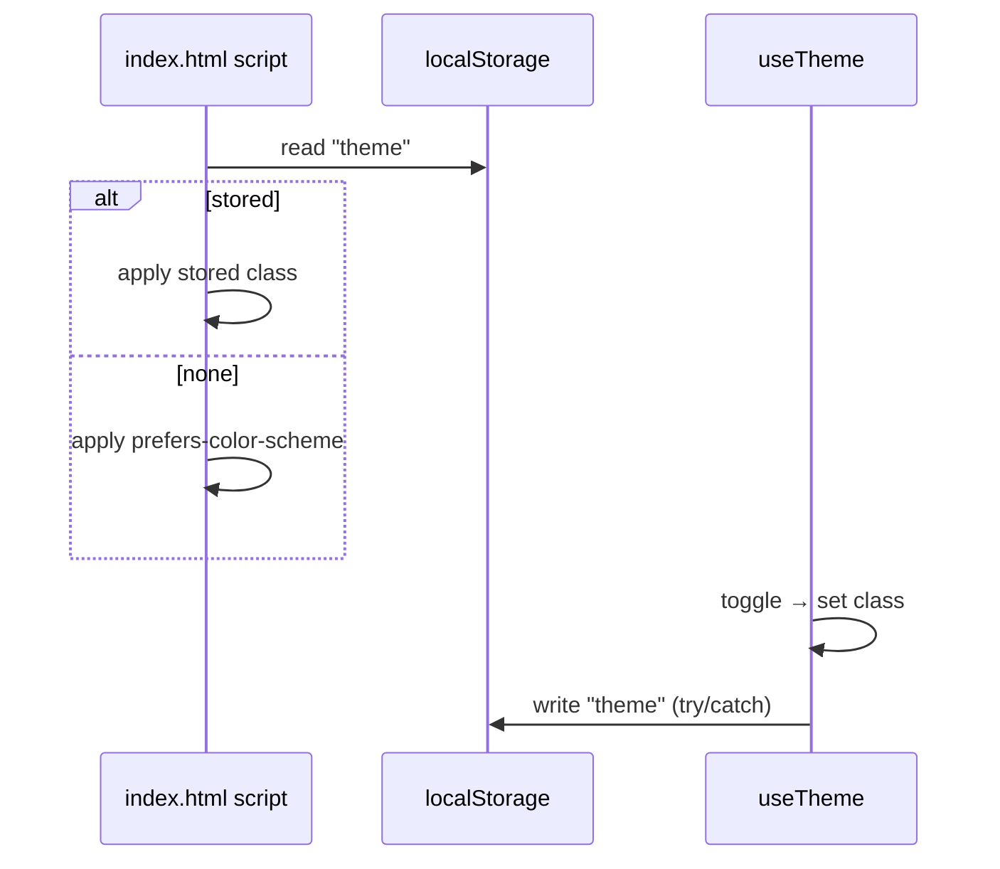
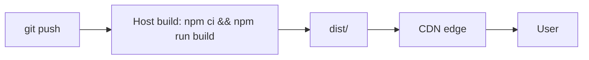

# System Design

## 1. Overview
A static single-page application. All content is compiled into the bundle from typed TypeScript modules. There is no runtime server component.

## 2. Component relationships

## 3. Page navigation and user flows
- **Recruiter:** Hero → Download Resume (if bundled) → Experience → Contact (mailto).
- **Developer:** Hero → View Projects → card → `/projects/:slug` → back to `/#projects`.
- **Deep link:** `/#achievements` loads Home and the scroll manager scrolls to the section.
- From a project page, header links point to `/#section`, returning to Home and scrolling.

## 4. Data flow
`src/data/*.ts` (typed constants) → imported by section components → rendered with ui primitives. `profile.ts` also supplies the per-route title/description set by `useDocumentMeta`. The static `<title>`, meta/OG tags and the JSON-LD `Person` block live in `index.html` (so crawlers see them without running JS) and are kept in sync with `profile.ts` by hand.

## 5. Contact flow
No form. "Email me" opens `mailto:` with a prefilled subject. Social links open in a new tab. Rationale: a form without a configured service would be non-functional, which the requirements forbid.

## 6. Project and resume navigation
- Project cards link internally to detail pages; GitHub/live links render only when defined.
- Resume button links to `/Ayush-Patel-Resume.pdf` with the `download` attribute; rendered only if the file existed at build (`__RESUME_AVAILABLE__`).

## 7. Theme preference

## 8. Performance and caching
- Single route chunk; icons tree-shaken; no images in the critical path.
- Fonts: preconnect + `display=swap`.
- Host should serve hashed assets with `Cache-Control: public, max-age=31536000, immutable` and `index.html` with `no-cache` (Vercel/Netlify defaults do this).

## 9. Security and privacy boundaries
Client-only; no user input is stored or transmitted. Only `localStorage` key: `theme`. No cookies, no analytics. Public data is limited to what the owner chose to publish (email, GitHub, LinkedIn). Phone is excluded.

## 10. Error and fallback behavior
| Situation | Behavior |
|---|---|
| Unknown URL / slug | NotFound page with link home |
| Resume PDF absent at build | Resume buttons not rendered |
| Project without GitHub/live URL | Link omitted; detail page notes "Source/demo link not published" |
| `localStorage` blocked | Theme still works for the session |
| JS disabled | Blank shell; `<noscript>` message with email and resume text |

## 11. Deployment architecture

SPA fallback rewrite sends every non-file path to `index.html`.
